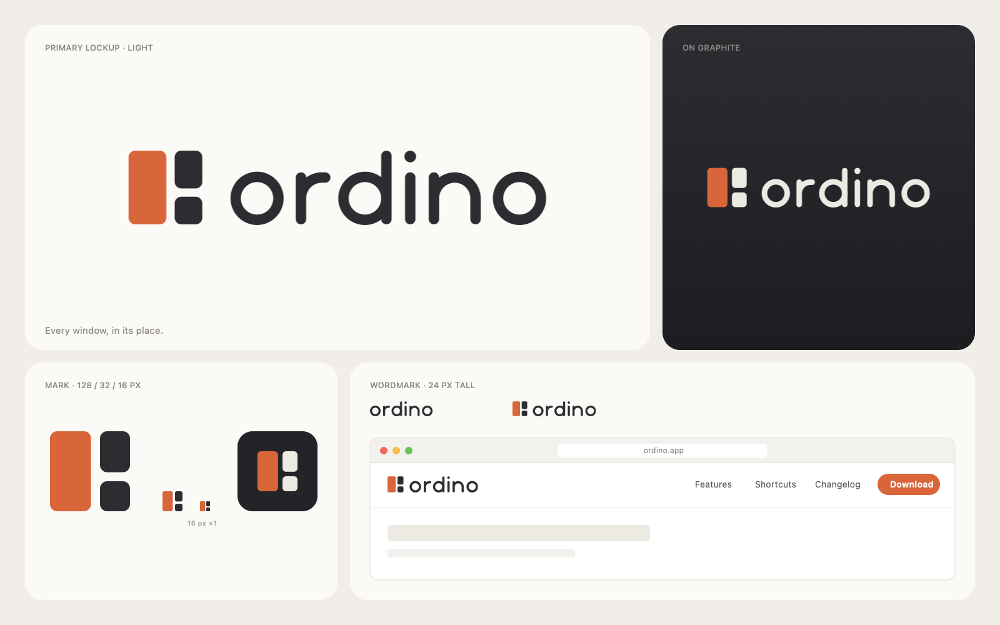

# ordino brand

## The logo

**Mark:** the app icon's three tiles, flattened: a tall terracotta *primary window* beside a stack of two. It says what ordino does: everything has its slot.

**Wordmark:** `ordino`, always lowercase. Monoline geometric letters with round terminals, drawn from circles and stems (no font involved, so there's nothing to license).

| File | Use |
|---|---|
| `logo-horizontal.svg` / `-dark.svg` | Default: website header, README, documents |
| `logo-stacked.svg` / `-dark.svg` | Square-ish spaces: about screens, social avatars with room |
| `logo-mark.svg` / `-dark.svg` | Where the name is already present or space is tight |
| `logo-wordmark.svg` / `-dark.svg` | Text-only contexts |
| `favicon.svg` | Browsers; switches its stack to off-white in dark mode |
| `png/` | Raster exports (`swift scripts/make-brand.swift` regenerates them from the SVGs) |
| `png/og-image.png` | 1200x630 social preview (Open Graph, GitHub) |
| `png/apple-touch-icon.png` | 180x180 for iOS/Safari bookmarks |

`-dark` files are for graphite or dark backgrounds.

## Construction

- **Mark grid 48:** primary tile 24.6 x 48, gap 5.4, stack 18 wide (top tile 24.6 tall, bottom 18 x 18). All corners radius 4.3, the same ratio as the app icon. Flat, no gradients or shadows.
- **Wordmark:** stem 4.8 on a 24 x-height (about 1/5), ascender 10, round caps everywhere, circles with 0.3 overshoot, n and r share one arch radius.
- **Lockup:** the mark spans ascender top to baseline; 13 units between mark and wordmark. The tile gap in the lockup (~3.8) matches the stem, so letters and tiles share one rhythm.

## Colour

| | Hex | Use |
|---|---|---|
| Terracotta | `#D9653B` | The primary tile only. The single accent colour. |
| Graphite | `#2B2D31` | Stack and text on light backgrounds |
| Off-white | `#EDEAE4` | Stack and text on dark backgrounds |
| Paper | `#FBFAF7` | Light backgrounds |
| Graphite deep | `#1C1D20` | Bottom of dark gradients |

## Rules

- **Clear space:** keep at least the stack's width (18/48 of the mark height) free on every side.
- **Minimum size:** mark 16 px, horizontal lockup 16 px tall, wordmark 12 px tall.
- Only the primary tile is terracotta. Don't recolour the stack, add effects, outline, rotate, stretch or rearrange the tiles.
- Don't capitalise the name ("ordino", never "Ordino") and don't set it in another typeface as a logo.
- On photos or busy backgrounds, put the logo on a paper or graphite panel.

Note: the wordmark's SVGs use stroked paths. They render correctly everywhere on screen; convert strokes to outlines before sending them to a printer.
